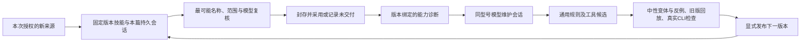

# 聚合物身份技能与通用能力提升

当前定位是可复用的polymer-identity技能、现有0.9.0化学内核/领域工具和持久Codex主会话。化学求解、复核和能力维护都用gpt-6.1-sol/xhigh；人工JSON不当训练答案、验收真值或主会话输入。已有案例用于发现一般问题，规则资料与真实工具检查用于支持能力扩展。

技能正文见resources/polymer-identity/SKILL.md，命名方法正文见resources/naming-guide.md。runner将该技能的solve.md复制到每个新job的skill-method.md，记录其哈希，与提示词和实现一起固定。主会话不读取capability-feedback、其他论文或历史答案。

封存后自动生成的identity-capability-feedback/1.0只保存路线、明确工具缺口、实际新路线使用及原版本绑定。反馈不包含名称/图答案库，不修改current.json、采用bundle或原封存记录。collect验证反馈与原封存一致后汇总待审问题，不自动生效。

能力维护会话在无活动论文的批次边界工作，保留原案例的模型结论不当真值。新规则须有IUPAC依据，代码改进须覆盖中性结构变体与反例；模型理由、工程测试、真实解析和CLI有效模型设置分别留证。运行中的批次不改技能/提示词/工具；新反馈只进入下一维护阶段。只允许当前用户明确授权的论文数量；闭环不授权后台继续跑旧队列或无限追加文献。

能力验证分为规则/工具检查通过、同型号模型复审完成、真实CLI入口通过、论文实际使用四种证据。未在新论文遇到某场景时，不能将“批次交付”视为该场景科学验证。候选图、确定性规则名、最可能IUPAC候选、严格优选名认证、实物身份仍是不同结论。
