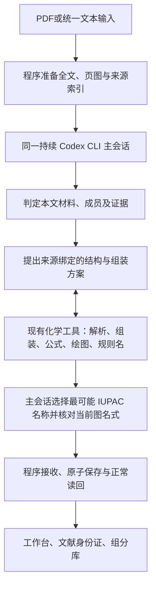

# 新流程建设详细设计（待用户确认）

任务：IDENTITY-SINGLE-CORE-DESIGN-20260930-01。日期：2026-09-30。

本文件是本次对话形成的设计候选，不是已交付能力。当前阶段只建设方案与执行交接。用户确认后，在新的开发聊天中建设独立应用目录；流程迁移和必要工程检查完成后，顺序实测三篇有人工JSON的论文，加一篇既有成员展示较好的参考论文，共四篇。旧流程、任务38和取消的论文队列保持原状态，不从本文件自动恢复。

## 1. 确定的建设目标

产品从文献或用户输入中形成可阅读、可追溯的高分子化学身份证。每个本文主要材料必须交付一个最可能的、有化学内容的 IUPAC 命名候选，配合对应结构表达、化学式范围、材料关系和简短依据。不能以样品编号、泛化类别或“无法认证严格优选名”替代这一交付。

采用三个界面入口：工作台、文献身份证、组分库。三入口读取同一身份对象、同一采用版本和同一份结构／名称绑定，不各建一套抽取、命名或数据库真相。

每篇论文的全部模型理解由一个持续 Codex CLI 主会话负责，运行模型固定为 gpt-6.1-sol、推理努力 xhigh。程序负责解析、来源定位、确定性化学工具、预算、接收、保存及读回。第一版不设固定辅助 Agent、独立视觉 Agent、总审 Agent或每成员 Agent。

建设新的应用目录，复用现有化学实现及必要依赖，不从零重写化学规则。运行内核仍为 0.9.0。新流程用一个显式入口标识区分，建议 `identity-single-core/1.0`；现有身份证、命名合同和旧作业语义不静默升级。

整体耗时与化学质量是待验证结果。减少交接、缩小上下文和保护收尾时间是本设计的措施，不能预先写成已经获得的提升。

**正式目标是一次启动后，无需人工补JSON、人工续接、点击采用或修页面，即获得正常入口可读、图名式同版的身份证。** 输入后的检查点恢复、有限局部修正、保存、采用、当前选择和页面投影均由程序完成。任何必须由开发者介入才能交付的首次运行，都不计为无人干预通过；修复后的效果另记。

## 2. 与现有流程的实质区别

| 项目 | 当前实际实现 | 新流程 |
|---|---|---|
| 模型责任 | 初读、目录／家族、视觉、共享身份、最终命名分别派发；新默认虽全为 Sol，仍保留多次重建请求 | 同一主会话从材料范围读到结构和名称，按需要调用工具 |
| 会话 | adapter 逐次 `exec --ephemeral`，以保存资料显式重建上下文 | 持久化会话；记录确切 session ID，必要时续接同一会话 |
| 正常输入 | 完整抽取包先经交接、接收、共享判断 | 完整来源可访问，主要身份与成员逐批构建，不等待大而全的性能抽取 |
| 读图 | 独立图片请求及观察交接 | 主会话直接读取相关原页／裁图，并将观察绑定来源 |
| 工具反馈 | 多阶段传回图、式、工具与诊断快照 | 工具直接返回实际接收后的当前状态；主会话据此命名 |
| 复核 | 有限多轮共享判断和独立最终命名请求 | 主会话完成一次当前状态的综合复核；实质变更才复核受影响目标 |
| 交付 | 历史工作流及接收合同参与较多 | 程序检查当前成果、原子保存、设置当前选择、正常读回；不新增模型保存角色 |

这些工作仍然需要完成，但不再把每项工作机械地变成新的模型角色或独立上下文。

## 3. 三块界面详细设计

### 3.1 工作台

入口 `/`。用于统一输入、任务管理、身份证阅读和明确修订。

上部是一块输入区域，接受文本／化学名称、已有结构与相关事实、PDF上传或选择；点击“生成化学身份证”启动相应任务。文本输入直接进入同一身份流程，不无意义地调用 PDF 解析。已有明确图的纯计算操作可直接调用化学底座，是否请求模型判断由用户动作及所需解释决定。

侧边展示近期任务及已保存身份，用来源短标题、原文代称和状态区分，不把长系统名称塞进选择按钮。任务进度只依据真实事件显示“准备来源、理解与构建、计算与命名、保存交付”，不按计时编造百分比。提供停止、查看已有成果和明确恢复本任务的动作；浏览页面不恢复其他任务。

主体采用连续身份证正文，依次显示身份摘要、最可能名称与结构、组成与组分、样品差异、身份相关制备依据。原文与未知项、工具记录、修订历史按需展开，不追加默认诊断大面板。化学名称完整换行、可复制；结构可以放大，图示范围就近显示。

系列先显示共同身份概览，上方用原文成员代称切换。共同结构与成员变化分别存储；切换成员后，名称、图、式、证据和版本必须同时切换。实物样品引用化学定义，但不继承其他样品的配方或测量。

修订动作明确目标和原因。纯显示／选择不触发模型；对来源、图或身份解释的修改在新修订中完成，保留原候选、撤回依据和旧版本。修订沿用本任务剩余预算，不在后台自动开启无限新任务。首次生成完成后自动保存并采用，无需用户再点击“采用”；历史版本选择只是可选的阅读动作。

### 3.2 文献身份证

入口 `/paper`。用于论文选择、本文材料组织、PDF定位和同一身份证的阅读。

论文目录显示标题、文献ID、处理状态和最近采用版本，支持上传／选择论文、查看任务和进入结果。默认结果只组织本文研究材料与影响其身份的必要对照。引用、背景材料另列可展开区域，不自动成为全部必须交付的主要目标。

阅读页由材料／成员导航、共享身份证正文和可打开的 PDF 证据区组成。PDF证据区按需要并排或在窄屏中折叠，避免挤压核心名称和结构。点击名称、结构、组分或结论的证据，可定位到真实页码和区域；裁图保留原页回退，不能将内部图片编号冒充原文 Figure／Scheme 标签。

同一论文可有聚合物定义、系列成员、混合物、前驱体与固化／改性样品。导航保留层次和原文代称，正文解释当前对象属于哪一层。共混关系不显示为共价连接；反应前后不因同一简称覆盖原对象。

已生成但未交付的结果仍可查看，并明确显示缺少的关键内容或保存问题。正常阅读只读已保存版本，不请求模型、外部查询或重新计算化学答案。

### 3.3 组分库

入口 `/knowledge`。第一版继续只维护组分，不建设另一套聚合物求解器。

列表和详情提供组分的来源名称／系统名称候选、实际结构、公式、电荷／盐／立体信息、使用角色及关联材料。原料、反应残基、反离子、溶剂和添加剂区分存储，不能将“解析出原料分子”显示为“确认它就是聚合物中的残基”。

本地已保存工具结果可复用，外部检索必须由明确的任务缺口或用户动作触发。详情能查看实际请求、返回来源、版本、失败与不一致。聚合物不能靠目录ID或参考答案直接获得整链结构。

历史参考组分可按明确入口只读查看，带原来源及版本标记；不混入新论文的求解答案。打开组分库或浏览条目不发生模型调用。

### 3.4 共享正文与页面行为

三入口用一个正文渲染器和一份已保存 bundle。对象选择由来源、owner、material、part及revision共同确定，异步旧响应不得覆盖新选择。长名称、多张结构、多个式范围及无图说明在桌面和窄屏均完整可达。

首屏必须让读者看清：这是什么材料、最可能的名称是什么、结构表达是什么、哪些内容已由原文支持、哪些仍为假设／未知。一般透过率、力学强度等性能不是本次默认抽取和页面扩张目标；完整原文仍保留。

## 4. 文献到身份证与命名的正常流程



### 4.1 程序准备输入

接收原PDF后计算哈希，生成独立任务ID，冻结新流程配置、主提示词、命名规则和化学实现版本。优先使用 MinerU 提取完整正文、表格、图像及位置；同PDF哈希、同解析选项且来源完整的缓存可复用，不能复用旧聚合物答案。

同时从原PDF生成独立页图，建立真实页码、原文图题、裁图区域与来源块索引。保留足够的图例及邻近文字，裁图缺少上下文时读取原页。页图独立保存，不把全论文缩成一张拼图。

原PDF、全文、页图和裁图始终可访问。主会话首轮读取全文及结构相关页，继续按需要查阅其余页。图片文件存在或已附加，只表示可用；“已经读取并用于判断”需要真实模型观察与来源引用。关键结构图未读不能记成原文未报告。

首版使用本地CLI已支持的图像方式和本地读取工具。当前检查的CLI帮助未显示原生PDF附件选项，因此不把原生PDF上传作为建设前提；若以后改变输入方案，另做明确实现和验收。

### 4.2 主会话识别材料与组织证据

主会话首先给出紧凑材料清单：本文研究对象、必要对照、化学定义、系列／成员、实物样品和关键组分，另标背景引用。每项记录有来源，材料角色不明确则保留不确定性。主要目标清单依据原文研究范围，不能简单将全部 polymers／variants 都判为主要材料。

抽取优先服务身份：明确构成、单体／残基、聚合／改性描述、端基、盐／电荷、立体、组成及基准、交联、关键制备和身份相关分子量。一般性能留在原始解析中，不先生成庞大性能JSON作为化学推理前置条件。

来源事实、模型假设和工具结果各自保留。缺口分为未读证据、歧义、相互冲突、原文未报告和工具不支持；这些状态不能混成一个“未知”。只为会影响身份的具体问题补读／检索，合理未知不触发无限补证。

### 4.3 同一会话构建结构与成员

主会话综合来源图、文字和必要组分工具结果，提出结构候选或显式组装方案。结构包含图示范围、来源、假设、端口／映射和目标对象；反应位点、残基保留与连接选择由模型作有依据的判断，确定性解释器不自行猜反应。

对系列先建立共同结构，再保存变量和成员替换。对共聚物保存组成单元及已知关系；没有序列证据时不造唯一交替链。对接枝保存主链、接枝残基与连接依据，未知位点不强行变成已确认连接。对网络保存可支持的前体、局部连接或理想化候选，明确未知拓扑。对共混物保存组分及非共价混合关系。

调用现有 Kernel／create_passport、片段连接、映射编辑、RDKit、组分解析等工具得到实际接收结构、图示范围内公式和图。工具结果直接写到任务目录并回传同一会话；主会话可局部修改，其他已完成成员不因一个错误全部重做。

有证据支持的结构必须生成实际绘图，不使用AI绘图代替化学图。重复单元、链端、CU集合、组分集合及局部网络采用对应显示方式。星号端口、原文R变量、重复括号和n各有明确含义；共混图不添加共价键。原文结构图与计算候选图保留不同来源标记。

公式来自实际编码图，并注明是重复单元、端段、局部残基、小分子或有限链；不能将重复式显示为实物聚合物唯一分子式。未给出聚合度、比例或网络拓扑时保留未知。

### 4.4 最可能 IUPAC 名称及综合复核

主会话读取实际接收的图、式、材料关系、规则名及证据，再确定最终命名候选。命名不得只依据最初提案、原料名称或样品简称。

每个主要材料交付一个首选的最可能候选，必要时保留少量具有实质差异的备选。系统必须保存名称正文、命名依据、适用范围、关联图／组分／来源、关键假设、简短选择理由和未解决项。

同一会话核对反应连接、保留基团、端基、立体／电荷／盐、共聚／接枝／共混关系和名称范围。实际结构、关系或相关证据变化，使受影响目标的旧复核失效；只重新计算和复核受影响部分。格式重排和管理字段变化不应迫使整篇再命名。

工具已返回实际状态且该状态被最终复核后，保存不再增加固定“终审模型”。接收器若发现实质问题，将具体差异反馈到同一session，在剩余预算内修正。

### 4.5 程序保存与读回

程序完成来源／引用合法性、工具结构结果和当前名称绑定检查，保存不可变结果及修订，把当前采用指针原子更新，并从正常页面/API读回同一对象、名称、图、式和版本。用户的生成／批次启动动作包含将合格的新结果自动设为本来源当前结果的授权，不设置额外人工采用步骤。

结构数据、绘图、公式、名称绑定及正文使用同一不可变bundle／revision。程序先生成完整bundle，再原子提交索引，避免图先更新而名称／式仍来自旧版本。浏览器只请求已发布的该版本；切成员时保留对应owner／material／part引用，旧异步响应丢弃。发生本地短暂写入或投影错误时自动使用已保存结果重试，不重新请求模型生成答案。

关键内容缺失、图名式矛盾、当前复核不匹配或保存／读回失败时保留已有成果并标记未交付，不用进程exit 0冒充完整身份证。原文合理未知可以随可用身份证交付，但“本应读取的证据未读”不能包装成合理未知。

## 5. IUPAC候选的明确产品要求

IUPAC高分子命名区分来源型与结构型。本产品根据证据选择合适路径，不能把一切材料强行命名成唯一完整链。[IUPAC高分子命名简明指南](https://iupac.org/wp-content/uploads/2019/07/140-Brief-Guide-to-Polymer-Nomenclature-Web-Final-d.pdf)

| 情形 | 最可能候选的选择 | 结构与范围要求 |
|---|---|---|
| 明确规则聚合物 | 优先基于实际CRU的结构型系统命名候选 | 对应实际重复图与端口；仅支持的立体信息进入名称 |
| 来源明确、构成不足 | 给出使用可辨识单体／组分的来源型候选 | 不由命名反推已证实聚合位点 |
| 不规则／共聚 | 按已知构成和连接关系命名，未知序列保持未知 | 不凭投料比宣称随机、统计、交替或嵌段 |
| 端基大分子 | 有依据时纳入端基说明，名称绑定重复图和端段 | 端基类型与真实端基分布区分 |
| 接枝／网络 | 使用证据支持的关系及组分／局部构成候选 | 不宣称唯一全链或唯一网络拓扑 |
| 共混／复合材料 | 给出系统组分名称及材料关系的最可能命名表达 | 整体标明材料组分命名表达，不能伪装成单一聚合物PIN |

“必须给出最可能的”意味着有支持时必须作出有用选择：例如无法认证优选CRU，也应给来源型候选；存在有限歧义时，可给最可能解释并就近标明假设。不能用“严格PIN未认证”把所有名称留空。

它不授权虚构证据。若来源连构成类别／组分都无法支持，系统应明确指出未满足名称交付要求并保留部分结果，不能随意造一个化学名来满足非空字段。主名称不能仅为“Polymer A”“sample 3a”“crosslinked polymer”。

界面主标签为“最可能 IUPAC 命名候选”，材料整体表达需要相应范围标签。候选图、确定性规则名、最可能命名候选、严格优选 IUPAC 名与真实材料身份分别记录；默认 `full_iupac_conformance=false`，独立审核 `NOT_REVIEWED`。模型自查、OPSIN可解析或RDKit可画均不能将这些声明提升为认证。

## 6. 单核心CLI执行设计

### 6.1 执行方式

主方案用 `codex exec` 启动持久化任务，不使用 `--ephemeral`；记录 `thread.started` 返回的确切session ID。需要继续时由运行器自动用该ID的 `codex exec resume`，不用 `--last`，无需用户人工续接。官方CLI支持这些机制，但能否在本机完整读取图像、调用工具、保存检查点和恢复任务，仍需工程预检及真实任务验证。[OpenAI CLI命令说明](https://learn.chatgpt.com/docs/developer-commands?surface=cli)

初始工作目录是该篇独立任务目录，显式使用 `workspace-write`，可写候选、检查点和工具文件。运行参数固定模型及xhigh；新应用的工具环境、Windows sandbox后端和实际生效权限都写入收据。不得绕过执行策略来掩盖缺少工具。[GPT-6.1 Sol官方模型资料](https://developers.openai.com/api/docs/models/gpt-6.1-sol)

主会话通过一个本地领域工具入口使用项目环境，建议形式 `python -m identity_app.tools <operation> --input <request.json> --output <result.json>`。这是设计接口，当前尚不存在。它只暴露来源读取、限定组分解析、显式组装、计算／绘图／命名、候选更新与当前快照等必要能力，不把旧批次调度或共享数据库发布工具暴露给论文任务。

程序不在每次工具调用后重建新Codex会话。正常路径让CLI自主完成各项工作；必要时才在同session补充原图、明确接收错误或预算收尾提示。一篇任务可包含多个底层模型和工具调用，“一个CLI核心”不等于一个provider请求。

### 6.2 工具与运行时预检

新执行器必须使用完整且可定位版本的CLI运行时，包括本版本实际需要的code-mode host及配套文件。不能继续只复制codex.exe并假设工具可用。认证信息仍由既有本机机制读取，不复制到源码、报告或执行器快照。

启动前确认模型参数、实际权限、项目Python、RDKit绘图、必要Java／OPSIN、图像读取与可写任务目录。版本探测只做一次并保存。迁移后允许一次很小的模型工具预检，以实际读文件、读测试图片、调用领域工具和写检查点确认能力；单独记为工程调用，不算论文验收。失败先修执行器，不启动四篇正式实测。

首版只选一种领域工具实现，不同时建设MCP、app-server、文件轮询等多套通路。优先本地CLI工具；遇到明确运行限制再记录选择理由并替换，不能让备用架构都成为默认依赖。

### 6.3 工作上下文与检查点

任务目录提供本篇指令、全文、来源索引、独立页图／裁图、结构候选、工具结果、当前状态和问题清单。它不放开发仓库的历史计划、旧队列、人工JSON、既有论文化学答案、全量研究日志或整套源码。

每次重要候选批次和工具执行后保存检查点。当前状态包含主要目标、来源引用、有效图与范围、图名式绑定、材料／成员关系、假设、未知、撤回及剩余预算。完整原文和实际工具结果在文件中保留，主会话可按引用读取；短摘要不能成为唯一科学依据。

先按同session持续执行。确有上下文限制且压缩不能保留必要信息时，才创建明确记录的接替session，继承任务ID、实际检查点和剩余预算，记录前后session及原因；它是异常恢复，不是默认按阶段分工。

### 6.4 初始预算与失败处理

以下为待实测的初始工程配置，不是性能承诺：每篇总墙钟上限60分钟，预留最后15分钟用于必要命名／修正、保存与读回。全部准备、调用、恢复均消耗同一截止时间。单并发不把排队时间混入化学执行耗时，另记录从用户启动到交付的时间。

领域工具在每次调用前检查真实剩余时间。进入收尾预留后停止非关键补证和普通查询。若CLI仍在长时间无产物的推理中，宿主必须通过本版本已验证方式发出收尾指令；如不能实时引导，保存可用文件、停止当前执行并在剩余时间内明确续接原session收尾。若session无法恢复，标记失败，不偷偷重置预算或开启新的整篇推理。

对本地接收／保存错误，优先利用已有完整输出进行零模型恢复。格式或实质反馈最多两次且必须有新信息／状态；同一错误、同一状态停止。明确瞬时网络错误最多恢复两次，未知远端调用是否完成时先检查已有输出，避免盲目重发。恢复次数不增加总时间。

用户停止后只停止本任务登记的进程及子进程，保留已得到成果、预算和收据。新应用只恢复明确指定的新作业，不扫描旧项目目录自动启动历史任务。

## 7. 数据、工具和验证怎样保持精简

只保留三类必要检查：来源与引用是否成立；结构计算及表示是否合法、范围是否正确；交付时图、名、式、版本和正常读取是否一致。模型综合判断仍由主会话负责，程序不能冒充材料身份或严格IUPAC认证。

任务状态是唯一当前候选，更新按目标／成员和明确依赖应用。避免同时维护多份职责相同的抽取包、交接包和全篇诊断副本。原始CLI输出、工具收据和最终不可变结果仍保存，不能为了目录整洁销毁失败。

缓存按工具输入、作用范围、实现／规则版本和必要证据绑定使用。纯图计算可按图和实现复用，材料归属、名称选择和源证据不能仅凭相同SMILES跨论文复用。结构与名称实际变化才失效相关计算；格式、显示或日志变化不重复检查全部对象。

原始值和规范值并存，数字、单位、数学表达和引用ID有明确接收规则。合同错误直接反馈具体字段，保留已有效目标，避免几十项观察因为一个引用或枚举问题整体被丢弃。一般性能不进入主要身份交付门槛。

## 8. 新目录和存储建设

建议应用目录：

`D:\work\szlab\project\on going\agent\polymer project\Polymer_Identity_App`

建议运行数据目录：

`D:\work\szlab\project\on going\agent\polymer project\Polymer_Identity_App_Data`

本轮已检查应用目录尚不存在，不在确认前创建这两个实施目录。原项目 `Polymer_Identity_V1` 保留历史、受保护基线和旧版本回放。

```text
Polymer_Identity_App/
  AGENTS.md                    当前开发边界与唯一设计入口
  README.md                    启动、安装、正常操作
  docs/DESIGN.md               确认后的本方案
  docs/STATUS.md               实际交付及已知问题
  src/identity_app/
    server.py                  三入口和必要API
    runner.py                  持续会话、预算和新任务状态
    tools.py                   必要领域工具入口
    store.py                   接收、版本、采用、撤回
    presentation.py            唯一正文投影
  polymer/                     现有化学实现及已验证依赖，保留命名空间
  web/                         三入口与共享身份证正文
  resources/                   只读规则、组分资料及必要配置
  tests/                       新应用工程回归，无人工参考求解答案
  runs/                        开发与迁移证据，每任务独立
  migration-manifest.json      原路径、目标、用途、哈希和依赖
  requirements*.txt            实际需要的固定依赖

Polymer_Identity_App_Data/
  jobs/<job-id>/
    AGENTS.md                  本篇化学任务指令，非开发指令
    input/                     PDF副本、全文、页图、裁图、来源索引
    state/                     当前目标、候选、问题、预算、session
    tools/                     实际请求及结果
    output/                    候选和最终成果
    execution/                 CLI事件、退出、实际权限和失败
  store/                       新应用的采用索引与修订存储
  cache/                       可校验解析与工具缓存
```

开发Codex在应用源码目录工作；论文Codex以单篇jobs目录为工作目录。这两种上下文有不同指令和允许动作，不让文献任务在开发根目录自由搜索历史资料。

新应用的数据路径由显式运行上下文提供。迁移必须处理当前 `polymer.common.ROOT`、注册库、规则资料、工具路径以及历史服务路径的实际依赖，不能只改一个ROOT或在导入后猴子补丁。化学包需要的静态资源逐项映射；新作业、候选、缓存和数据库写入全部落入新数据目录。

迁移后的正常启动与新论文执行应在旧项目不作为运行时路径依赖时工作。旧项目仅用于显式旧版本回放／迁移核对，不被新server整体导入，不自动扫描其runs或复用其任务恢复器。新运行器登记本次明确启动的任务，可在进程故障后自动恢复这些任务并继承原预算；不要求用户手工执行续接命令。

## 9. 迁移范围与实施顺序

### 9.1 必须保留的实现与行为

| 能力 | 已有实现起点 | 迁移要求 |
|---|---|---|
| 化学解析与统一身份 | kernel.py、passport.py、registry.py、periodic.py及依赖 | 同一实现，保持0.9.0和旧命名含义 |
| 系统命名与规则 | naming_service.py及现有规则／知识实现 | 候选与认证声明分开，不新建第二命名器 |
| 结构组装 | identity_reasoning_assembly.py、映射编辑、片段连接、位点工具 | 明确来源、端口、选择和假设 |
| 实际绘图／式 | RDKit及structure_reconstructions.py、现有重复图显示 | 原图、候选图与公式范围可核对 |
| 组分解析 | 现有OPSIN、本地库及限定公共查询 | 只解具体组分问题，实际调用和失败可追溯 |
| 保存与采用 | passport_revision_store.py、修订／撤回生命周期及当前选择语义 | 新独立存储，保持来源／版本／撤回含义 |
| 证据定位 | 当前MinerU、原页和裁图实现 | 保留来源哈希、页、区域和未读状态 |
| 正文阅读 | 当前连续阅读、成员切换、图名式绑定 | 新三入口复用一套渲染与数据 |

上述是起点而非已经算出的最小复制清单。迁移阶段必须跟踪静态和动态导入、静态资源、数据文件和命令入口的真实依赖。允许先保留小规模必要兼容模块，再按实际调用证据收窄，不能为了少文件删掉隐含算法能力。

### 9.2 新默认流程不继承的内容

不迁入旧论文队列、AUTOPILOT／H1调度、旧provider角色链、全量runs/archive、历史整体方案、一次性审计／发布脚本、人工参考JSON、旧论文化学答案、整套server历史路由或workspace_shell的全部脚本注入。

已有保护测试、schema、spec及冻结报告留在原位置且不改要求。新应用可复制明确需要的兼容契约与合法工程测试资料，但不能修改原测试、消除旧失败、把自己生成的结构列为独立真值。凭文件名中的旧版本号也不能断定算法无用。

### 9.3 分阶段交付

1. **冻结迁移源。** 基于当前工作文件，包括必要未跟踪文件，生成清单与哈希，不只取旧Git HEAD。创建新应用及新数据目录；原目录不移动、不覆盖。建立一个开发分支，推荐 `codex/single-core-flow`，默认单开发主任务。
2. **接通化学底座和路径。** 迁入经核实的依赖、固定资源及必要本地工具，隔离所有写路径。以必要工程回归确认立体、盐／电荷、端口、成员、关系、公式和命名不退化，旧版本阅读仍可用。
3. **建设主会话与接收。** 准备源资料、CLI完整运行时、领域工具入口、实际状态、预算、候选保存、精确撤回和当前采用。先用工程工具预检确认可执行，不能只移除ephemeral或换模型就宣称完成。
4. **迁移三入口。** 用精简server接入同一正文，核对图名式、成员切换、来源定位、版本读回和窄屏阅读。普通浏览模型调用为0。
5. **冻结实测候选。** 记录代码／资源／提示词哈希、CLI版本、实际工具环境和预算。完成必要工程检查后，顺序执行三篇加一篇成员展示参考文献，共四篇单并发实测。
6. **写实际结论。** 封存首次结果及自动恢复，逐篇人工参考查看，并对成员参考文献做简单新旧页面对照，写效果、耗时、失败、未知和限制。人工介入后的结果不得计为首次无人干预通过。通过后才讨论正式切换默认入口；旧应用仍保留回放。

建设过程中不发布、不迁共享数据库、不扩大研究批次、不增加固定复核Agent。文档确认不等于实现完成，测试通过不等于科学完成。

## 10. 三篇实测加一篇成员展示参考

来源根目录：`D:\work\szlab\project\on going\高分子材料\polymer\polyinfo数据`。

已核实如下PDF及对应JSON文件存在，JSON本轮只计算哈希，未解析内容。文件名对应人工参考的资格来自用户提供的数据定位，尚未独立审核其制作过程。

| 顺序 | 文献ID／标题 | 页数 | 直接参考JSON数 | 本轮观察重点 |
|---|---|---:|---:|---|
| 1 | 0021850 — Photopolymer: synthesis and characterization of poly(4-methacryloyloxyphenyl-4'-chlorostyryl ketone) | 6 | 1 | 主体聚合物、侧基和光反应材料状态区分，图名式对应 |
| 2 | 0072665 — Crystalline structure of poly(diaryl siloxanes) | 4 | 3 | 硅氧主链、芳基替换、系列／成员及结构型候选 |
| 3 | 0022930 — Effect of Grafted PP on the Properties of Thermoplastic Elastomers Based on PP-EPDM Blends | 8 | 8 | 主体／背景范围、共混与接枝层级、残基及有用命名 |
| 4 | 0000573 — Polyguanamines（现有保存来源） | 6 | 9 | 2a／2b与3a／3b等对象区分、系列概览、成员切换及整体图名式阅读 |

PDF均使用 `所有文献/reference_no_<id>.pdf`，参考JSON在 `有doi/reference_no_<id>/`。完整路径和哈希在 `paper-selection.json`，它是本设计／事后查阅资料，不作为论文核心输入。

0021850和0022930已在旧流程出现失败／暂停，0000573有可用既有结果，因此本轮不能宣称四篇都是陌生盲测。0072665的历史处理情况本轮没有认证。前三篇选择根据PDF标题、篇幅和材料类型；第四篇根据用户补充的成员显示参考需求，不根据人工答案调提示词或选“容易命中的结构”。

0000573的PDF哈希与既有任务 `FP-20260929T062607Z-181d2576` 来源完全一致，现有保存结果含2a、2b、3a、3b等代称。它用于迁移防退化和整体效果参考，不作为求解答案。2系列与3系列具体对象类型仍须由原文判定，不能仅因代称相近把小分子／环化产物与聚合物混作同一成员。

### 10.1 执行约束

迁移完成后从四篇原PDF的新任务入口开始，顺序为1→2→3→4，论文及模型核心并发均为1。允许校验过的解析／组分工具缓存，不传旧聚合物结构／名称、旧共享判断或人工JSON。按本轮用户补充，第四篇明确授权为成员展示参考；不得再启动第五篇、旧批次或取消队列。

求解目录只放本篇源资料和必要任务指令，不给核心会话人工JSON路径、参考manifest、文件名中含答案的组分列表或人工结构截图。主提示词明确不搜索人工参考／旧化学答案；记录实际CLI和工具读取行为，发现污染则该次不能计为自动结果。workspace-write本身不是阻止任意文件读取的充分证据，不能仅凭sandbox名称宣称隔离完成。

每篇先完成并封存自动结果及其哈希，之后监督方再打开对应人工JSON。人工参考只用于大致判断本文主要材料是否找到、图和名称是否合理、材料层次及关键组成是否相符。名称字符串不同、画法不同或额外合理未知不机械判错；参考本身也可能不完整或错误，必要时回查原PDF。

每篇写一段简明人工查看记录，引用具体对象及少量差异。**不建设验证比较脚本、模块、自动评分器或精确匹配指标。** `paper-selection.json`仅为静态输入与参考文件清单，不能演变为求解或比较程序。

第一篇若暴露共性执行／接收错误，先保留首次失败；该次不能计为无人干预通过。运行器能够自行完成的有限修正／恢复沿原预算执行，不能让监督方补JSON、人工续接或点击采用。确需修改代码／页面时，明确记为工程介入和新版本，不把修复后结果混入首次效果。若修复后需追加一次完整重跑，说明必要性和新增调用，按用户确认的实测范围执行，不偷偷扩成反复跑批。

为避免参照后反向调参，四篇运行期间不因人工命名／图画差异调求解器。若人工查看提示关键科学错误，先保留并报告，在四篇结束后讨论通用改进；不能把按参考修正后的结果称为原始自动表现。

第四篇封存自动结果后，对现有只读页面／保存快照与新页面做简单查看：系列默认概览、2a／2b与3a／3b切换、名称／图／式共同变化、原文证据与来源、长名称及图像可读性。保留少量同对象截图和简短结论，不新增页面比较模块或评价矩阵。旧结果只在监督方只读参考环境查看，不进入新核心输入；不为看旧页面启动旧队列恢复。

### 10.2 每篇实际交付判定

必须形成本文主要对象清单，并为主要材料给出最可能IUPAC候选、结构或有化学内容的组成／关系表达、公式范围、依据和未知；关键证据已读或有明确无法读取记录；当前图名式及版本一致，自动正式保存、自动采用且正常页面直接可读。技术上无法读关键证据时保留失败，不称为通过。

无人干预判定从一次用户启动开始，直到正常入口自动出现新结果。检查实际有没有人工补JSON、手工执行续接、点击采用、修页面／代码或用旧结果填空。出现任一必要人工补救，该次即不满足目标；运行器自身在原预算内的恢复可以计入流程，但须记录。

允许实物链长、序列、端基分布、拓扑等原文未报告信息保持未知。源图误读、主要对象漏掉、关键结构／名称未形成、工具缺失、保存失败则如实标记相应失败／未交付，不能统一为“合理PARTIAL”后宣布通过。

实际记录：启动到交付的时间、准备／主会话／工具／保存各段耗时、CLI启动／续接次数、实际模型用量（可观察部分）、外部工具成功／失败、流程内修复、主要材料的图名式、读回结果和人工大致判断。内部provider次数或费用不可观察则写UNKNOWN，不用CLI进程数替代。

四篇均一次启动自动交付可读结果、主要身份没有明显关键矛盾，且成员展示参考不明显退化，才能支持“这四篇来源的单并发辅助流程满足本轮无人干预交付要求”。不能外推广泛准确率、严格IUPAC认证或独立化学审核。若耗时仍长，使用本轮真实时序定位下一瓶颈，不再默认追加交接或审查层。

## 11. 工程验证与保护边界

实施阶段新增必要工程测试，覆盖工具可用和实际权限、同session续接与预算不重置、具体候选局部更新、来源／成员归属、图名式绑定、撤回不复活、保存／选择／读回、三入口无模型浏览及关键页面操作。它们不解析人工JSON、不以人工参考结构作运行时答案。

使用相关原回归防止化学底座退化；按影响范围决定是否运行全量pytest和verify_handoff，保留实际命令／退出及既有失败。不修改受保护测试、schema、spec或冻结报告来制造绿色基线。旧已知10项命名范围冲突仍保留；历史全量87失败与27缺失报告不因新目录自动消失。

运行内核、立体／同位素／盐／电荷／端口、occurrence、graft角色、未知、命名版本与旧回放语义不变。任何必要语义改动需显式版本／决策，不能隐藏为搬目录。

## 12. 确认与新窗口执行边界

本轮完成本设计、三篇加一篇选择清单和新窗口交接，不启动实施、新服务、模型抽取或旧任务。用户确认本方案后，新开发聊天按 `NEXT_WINDOW.md` 执行迁移及四篇单并发实测，执行时不再为每次必要本地工具、MinerU、模型或组分调用重复询问。

新开发聊天与每篇论文核心session是两种不同层次：开发聊天建设应用，运行器创建四篇依次执行的科学任务。默认单开发主任务，不创建固定辅助Agent。此处没有要求自动创建新聊天；用户确认并明确要求打开／创建时再操作。

方案确认后仍需从实际依赖清单、完整CLI运行时与独立数据路径开始实施。当前最先需要证明的能力是：核心会话可以真实读源图、调用原化学工具、写检查点并用实际结果命名，而不是仅能返回一段文本。

本轮收尾核对时，`docs/IDENTITY_WORKFLOW.md`与`polymer/literature/workflow/agent_transport.py`相对初读哈希发生变化，本轮没有编辑这两份文件。前后哈希及核对失败保存在evidence.json，不声称现有依赖全部稳定。新窗口冻结迁移源时须再次读取实际代码和当前状态；本设计提出的职责与交付目标不依赖把旧流程某个历史版本视为最终实现。
