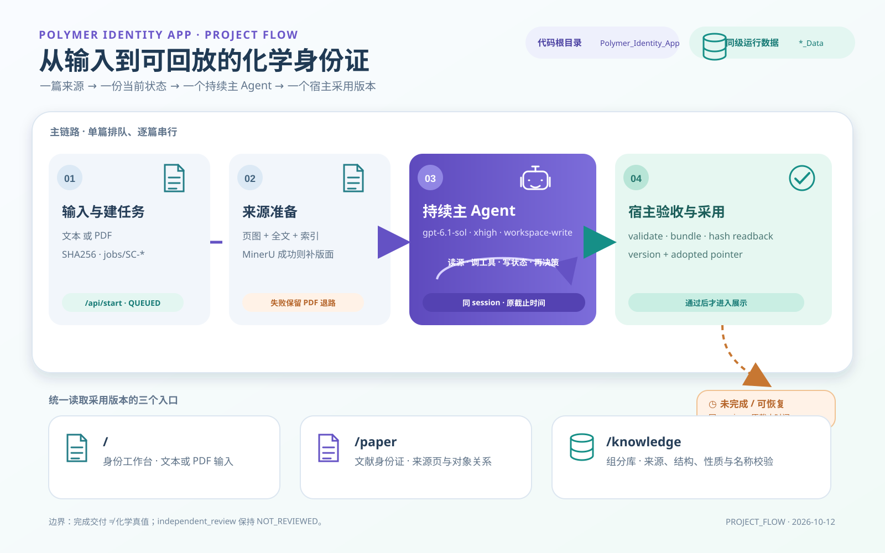
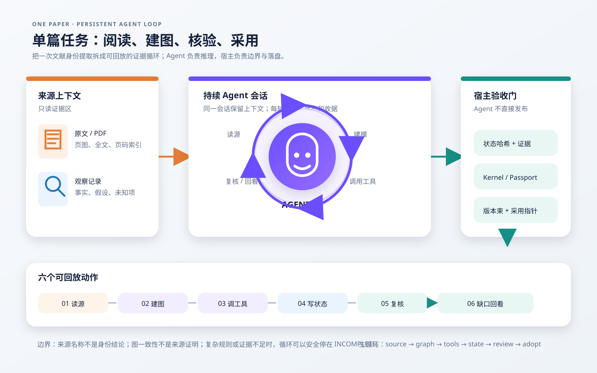

# Polymer Identity App 项目流程说明

> 核对日期：2026-10-12  
> 本文按当前 `Polymer_Identity_App` 实际代码、配置和运行目录整理。它描述系统的工程流程与化学声明边界，不把工程测试当作独立化学审核。

## 一页结论

项目由两个同级目录组成：

- **代码根目录**：`D:\\work\\szlab\\project\\on going\\agent\\polymer project\\Polymer_Identity_App`
- **运行数据根目录**：`D:\\work\\szlab\\project\\on going\\agent\\polymer project\\Polymer_Identity_App_Data`

代码目录保存 Python 应用、聚合物化学内核、技能、网页和测试；同级 `Polymer_Identity_App_Data` 保存任务、来源页图、运行时、私有配置、采用版本、日志和缓存。项目内部的 `Polymer_Identity_App\\data` 只保存轻量配置与规则快照，不能当作任务运行数据根目录。

当前实际运行合同为 `identity-single-core/1.0`，化学内核为 `0.9.0`。每篇授权文献创建一个任务，使用一个持续的 `gpt-6.1-sol / xhigh / workspace-write` 会话，宿主以单并发队列执行。完成后的结果必须通过宿主校验、写入不可变 bundle、生成采用指针并读回 hash，才会显示到页面。





## 1. 实际目录和职责

| 路径 | 真实职责 | 典型内容 |
|---|---|---|
| `Polymer_Identity_App\\identity_app` | 应用服务、任务驱动、来源准备、工具表面、采用与版本 | `server.py`、`runner.py`、`source.py`、`tools.py`、`storage.py` |
| `Polymer_Identity_App\\polymer` | 聚合物化学内核与文献接入 | Kernel、passport、NamingService、结构、周期单元、MinerU 适配 |
| `Polymer_Identity_App\\resources` | 主提示词、技能和命名合同 | `core-prompt.md`、`polymer-identity/SKILL.md`、`naming-guide.md` |
| `Polymer_Identity_App\\web` | 前端工作台、文献身份证和组分库 | `index.html`、`app.js`、`library.js`、CSS |
| `Polymer_Identity_App\\config` | 运行时定位与版本绑定 | `runtime.json` |
| `Polymer_Identity_App\\data` | 配置、规则、注册表和轻量本地快照 | `iupac_rule_coverage_v2.json`、注册表快照 |
| `Polymer_Identity_App\\docs` | 设计、状态、命名和本项目流程文档 | 本文件及既有 ADR |
| `Polymer_Identity_App\\tests` | 工程回归测试 | pytest、Node 阅读器测试 |
| `Polymer_Identity_App\\runs` | 运行报告、封存证据和历史任务说明 | 每个授权任务一个独立目录 |
| `Polymer_Identity_App_Data\\jobs` | 当前任务工作区 | `SC-*/run.json`、来源、调用和状态 |
| `Polymer_Identity_App_Data\\source`、`ocr` | 已保存来源、OCR 或阅读材料 | 按任务或批次组织 |
| `Polymer_Identity_App_Data\\versions` | 不可变采用 bundle | 以版本 hash 命名的目录 |
| `Polymer_Identity_App_Data\\adopted` | 来源 SHA 到采用版本的指针 | 采用时间、版本和来源 hash |
| `Polymer_Identity_App_Data\\private` | 私有 MinerU 配置及任务私有材料 | 不进入文档或答案 |
| `Polymer_Identity_App_Data\\runtime` | Codex CLI 运行时及校验文件 | `codex.exe` 等 |
| `Polymer_Identity_App_Data\\logs`、`cache` | 服务日志和只读投影缓存 | 不作为化学求解输入 |

代码通过 `config/runtime.json` 找到 Python、Codex CLI 和 `data_root`。如需临时切换数据目录，可设置环境变量 `IDENTITY_APP_DATA`；没有设置时使用 `runtime.json` 的同级 `Polymer_Identity_App_Data`。

## 2. 启动应用

在 PowerShell 中执行：

```powershell
cd "D:\\work\\szlab\\project\\on going\\agent\\polymer project\\Polymer_Identity_App"
.\\start.ps1
```

`start.ps1` 会：

1. 将当前目录设为项目根目录；
2. 读取 `config/runtime.json`；
3. 使用其中的 Python 启动 `python -m identity_app.server`；
4. 开启单工作线程和组分库补充、名称检查后台线程；
5. 默认监听 `http://127.0.0.1:8780`。

指定端口：

```powershell
.\\start.ps1 -Port 8785
```

启动后可以检查：

```text
http://127.0.0.1:8780/api/health
```

健康接口会返回合同、Kernel 版本、当前活动任务、并发数和 preflight 状态。停止服务使用当前 PowerShell 窗口的 `Ctrl+C`；停止服务不会删除任务、采用版本或日志。

## 3. 三个网页入口

| 地址 | 用途 | 主要数据来源 |
|---|---|---|
| `/` | 身份证工作台 | 文本或 PDF 输入、任务进度、最新完成结果 |
| `/paper` | 文献身份证 | 来源文献、页图、材料对象、关系、名称和版本 |
| `/knowledge` | 组分库 | 组分来源、有限结构、工具性质、名称检查、材料关联 |
| `/library` | 组分库兼容入口 | 与 `/knowledge` 共用同一服务接口 |

三个入口都读取同一不可变采用版本。组分库不是另外复制一份化学结果，而是从采用 bundle 投影出组分、来源和校验信息。页面中的结构候选、确定性规则名、最可能 IUPAC 名称、优选名认证和真实材料身份仍然是不同层次的声明。

## 4. 从输入到任务队列

### 4.1 前端提交

网页只允许一次选择一种来源：

- 输入文本；或
- 上传 PDF。

前端向 `POST /api/start` 发送文本或 `pdf_base64`。服务端检查输入类型、文本长度、PDF 头和大小。PDF 暂存到运行数据根目录的 `uploads`，随后调用 `runner.init_job` 创建新的 `SC-...` 任务目录。

初始化时会保存：

- `run.json`：任务合同、来源 SHA、模型、预算、状态；
- `input.txt` 或 `source.pdf`；
- `current.json`：材料、图、关系、观察和撤回记录的当前状态；
- `AGENTS.md`：本任务固定的核心提示词；
- `naming-guide.md`：命名方法；
- `skill-method.md`：聚合物身份技能方法；
- `implementation.json`：代码、资源、运行时和提示词 hash。

之后状态变为 `QUEUED`，任务进入服务端的 `WORK` 队列。当前服务只允许一个活动任务；其他任务在队列中等待。

### 4.2 任务预算

新任务默认 60 分钟。最后 15 分钟是收尾保留时间：

- 不再开始新的开放式组分或公共查询；
- 优先补齐当前错误、保存回执、复核和交付；
- 超过截止时间的任务不能通过普通恢复重置预算。

`resume` 沿用原任务的 session 和原截止时间，不重新开始一篇论文，也不把预算清零。

## 5. 运行时预检

队列开始新任务前调用 `require_preflight`。preflight 是工程门，不是化学正确性证明。它会创建一个无论文的中性任务，检查：

- 当前实现 hash 与运行记录一致；
- Codex CLI 文件存在且 hash 一致；
- 主会话能读一个小图像；
- `check_structure` 能写真实图响应；
- OPSIN 能完成有限分子解析并进行图匹配；
- 同一 session 能恢复并写回检查点；
- 模型、reasoning effort 和 workspace-write 设置符合当前合同。

缺少或过期时，服务会先运行一次 preflight；失败则任务不会进入真正的论文求解。工程 preflight 通过只说明调用链可运行，不能说明论文中的材料身份正确。

## 6. 来源准备

### 6.1 文本输入

文本任务直接保存为 `input.txt`，生成只有一个 `text:input` 来源块：

- `source-index.json` 的 `page_count` 为 0；
- `fulltext.md` 保存规范化输入；
- 模型不能假设存在 PDF 图页。

### 6.2 PDF 输入

PDF 任务首先由 PyMuPDF 读取：

1. 保存原 PDF；
2. 逐页生成 `pages/page-XXX.png`；
3. 把每页文字写入 `pdf-text.md`；
4. 生成带页码、块 ID 和来源 SHA 的 `source-index.json`。

系统随后尝试调用 MinerU 补充版面、图文块和资源绑定。每次提交、上传、轮询、下载和解压都有 `mineru/receipt.json` 回执。若远端解析、网络、下载或 ZIP 校验失败：

- 原 PDF 页图仍保留；
- `fulltext.md` 回退到 `pdf-text.md`；
- `source-index.json` 记录 `parser_failure`；
- 任务不会把解析失败伪装成成功。

因此，MinerU 是来源增强层，不是化学推理层；直接 PDF 文本和原页图仍是任务的来源底座。

## 7. 持续主 Agent

`runner.run_job` 在本任务目录中调用 Codex CLI：

- 初次调用使用当前任务的 `AGENTS.md`、全文和来源索引；
- 主会话只访问本篇来源、当前状态和允许的领域工具；
- 不读取其他论文、旧答案或人工参考 JSON 作为求解输入；
- 使用 `gpt-6.1-sol`、`xhigh` 和 `workspace-write`；
- 每次调用保存 prompt、command、stdout JSONL、stderr、receipt 和运行环境引用；
- CLI 遇到具体缺口时，在同一个 session 内有限恢复。

Agent 的工作不是一次性输出大 JSON，而是逐步写入 `current.json`，由工具回执和状态 hash 支撑后续判断。它可以根据来源和当前对象选择下一步，但每一步都受到合同、预算和宿主验收约束。

## 8. 可检查的工具循环

工具入口是任务目录中的 `run_tool.py`，实现位于 `identity_app/tools.py`。主要操作如下：

| 操作 | 作用 | 关键边界 |
|---|---|---|
| `read_source` | 读取全文、页或指定来源块 | 只读当前任务来源 |
| `crop` / `observe` | 截取图页、保存模型观察 | 观察不是独立事实 |
| `check_structure` | RDKit 解析、规范化、式、端口、图示和性质 | 图的 scope 必须明确 |
| `prepare_component` | 为有限组分准备有来源的名称查询 | 保留原名、来源和准备理由 |
| `resolve` | OPSIN 有限名称到候选图 | 解析成功不等于材料身份成立 |
| `check_substituent` | 检查有一个开放端口的取代基 | 只在有限图范围使用 |
| `prepare_constitution` / `derive_constitution` | 从有限图生成受限构成候选 | 需要来源证据和明确局部范围 |
| `public_lookup` | 有界公共候选查询 | 不用于证明整个聚合物 |
| `profile` / `name` / `declared_cru` | 图性质、规则名和声明 CRU 处理 | 记录规则版本与拒绝原因 |
| `assemble` | 组装有限候选或局部结构 | 局部结构不能冒充完整实物图 |
| `bind_receipt` | 把工具回执绑定到当前对象 | 对象、图和来源必须对应 |
| `upsert` | 写入或更新当前材料、关系和图 | 更新保留撤回记录 |
| `review` / `review_naming` | 复核身份、来源和命名声明 | 状态 hash 绑定当前依赖 |
| `finalize` | 形成可交付的当前候选 | 仍需宿主最终 validate |
| `finish` | 请求结束并返回交付状态 | 只有 READY_FOR_HOST_COMMIT 才能进入宿主采用 |

典型循环是：

1. 读取原文和图页；
2. 建立材料、组分、关系、图和来源引用；
3. 对需要确定性检查的范围调用 RDKit、OPSIN 或有限公共候选工具；
4. 保存实际回执和失败信息；
5. 运行 `review`、命名复核和必要的 `finalize`；
6. 发现缺口时回到相关页，进行有限修补；
7. 通过后调用 `finish`。

## 9. 化学身份证和 IUPAC 声明边界

每个材料对象至少需要标签、类型、来源引用和当前状态。主要结构范围包括：

- `finite_molecule`：有限组分或有限候选；
- `repeat_unit` / `constitutional_unit`：明确开放端口的周期或构成候选；
- `local_network`、`end_group`、`residue`：局部网络、端基或残基；
- `component`、`oligomer`：有限对象或低聚对象。

系统分别保存：

- 原文事实与页码；
- 图和原子映射、立构、同位素、电荷、盐和端口；
- 材料、组分、共混、共价连接和工艺辅助关系；
- 观察、假设、未知和冲突；
- 工具调用、输入、输出、状态和失败；
- 命名候选、适用范围、依据、理由和规则 trace。

### 9.1 名称路线

- 有限分子名称可以通过 OPSIN 得到候选图，再与当前有限图进行比较；
- 周期构成和高分子结构使用 Kernel、NamingService 及受限命名合同；
- 来源型名称、结构型名称、候选名称和严格优选名分开保存；
- 取代、接枝、网络、共混、序列、立构、端基或连接位点未被来源支持时，保留未知或范围性声明；
- PubChem、CIR 或 OPSIN 返回一个名字，不等于已经证明论文中的实物身份；
- `certified_preferred_name` 和 `independently_reviewed` 不由模型自行写入。

当前页面可以显示最可能 IUPAC 候选和其依据，但 `independent_review` 保持 `NOT_REVIEWED`。图名往返一致、RDKit 合法或工具解析成功，都不能替代原文证据与独立化学审核。

## 10. 复核、结束和宿主采用

Agent 的 `finish` 只产生 `READY_FOR_HOST_COMMIT` 或未完成状态。宿主随后执行：

1. 从 `current.json` 读取候选；
2. 运行 `storage.validate`；
3. 检查材料、来源块、关系、图、命名复核、工具回执、状态 hash 和必要字段；
4. 失败则写入 `INCOMPLETE`，保留当前状态和错误列表；
5. 通过则构建 bundle，写入 `versions/<sha256>/bundle.json`；
6. 写入 `adopted/<source_sha>.json` 和任务的 `adopted.json`；
7. 重新读回 bundle 并验证 hash；
8. 将状态置为 `DELIVERED`，再由页面和组分库读取。

采用是宿主动作，不是模型一句“完成”就自动发生。输入、图、关系、工具回执或依赖对象改变后，相关 review 状态会失效，必须重新复核。

## 11. 未完成和恢复

恢复只在原任务尚未封存、截止时间未过且没有活动实例时允许：

```powershell
python -m identity_app.runner resume --job "D:\\work\\szlab\\project\\on going\\agent\\polymer project\\Polymer_Identity_App_Data\\jobs\\SC-YYYYMMDDTHHMMSSZ-xxxxxxxx"
```

恢复特征：

- 使用原任务目录和同一个 session；
- 不重置 60 分钟预算；
- 优先读取已有 snapshot 和错误；
- 最多进行有界的同 session 恢复；
- 模型容量错误使用短暂退避；
- 到达收尾窗口后停止新的开放式查询；
- 已封存任务不能原地改写，必须创建新任务或显式 revision。

下列状态应被保留并在页面中显示，而不是伪装成交付：

- `INCOMPLETE`：合同或证据尚未满足；
- `STOPPED`：用户或宿主请求停止；
- `ENGINEERING_FAILED`：服务或实现层异常；
- MinerU 失败、工具不支持、来源冲突或身份未知。

## 12. 页面读取和组分库更新

页面读取的是 `public_bundle_for` 返回的已交付版本：

- 文献页显示来源摘要、页图、主要材料、组分、关系、名称、身份范围和历史版本；
- 身份工作台显示文本任务状态、完成结果和原始输入；
- 组分库按采用版本投影组分，显示来源数量、角色、结构、有限图性质、名称检查和相关材料；
- PubChem 性质补充、组分名称检查和阅读器缓存属于独立后台路径；
- 后台补充不会修改原论文求解预算，也不会把外部候选直接写成来源事实。

## 13. 直接 CLI 使用

使用项目配置中的 Python 运行工程预检：

```powershell
cd "D:\\work\\szlab\\project\\on going\\agent\\polymer project\\Polymer_Identity_App"
python -m identity_app.runner preflight
```

提交 PDF：

```powershell
python -m identity_app.runner run --pdf "D:\\path\\paper.pdf"
```

提交文本：

```powershell
python -m identity_app.runner run --text "这里写材料描述"
```

指定预算仅适合新任务：

```powershell
python -m identity_app.runner run --pdf "D:\\path\\paper.pdf" --minutes 60
```

直接 CLI 也要求 preflight 通过，并会生成同样的任务目录、调用回执、当前状态、封存文件和采用版本。生产使用前应优先通过网页入口，方便查看状态和最终身份证。

## 14. 任务文件速查

| 文件 | 作用 |
|---|---|
| `run.json` | 状态、合同、模型、预算、截止时间、调用和交付 |
| `current.json` | 当前候选材料、关系、图、观察、未知和撤回 |
| `source-index.json` | 来源块、页码、图片和来源 hash |
| `fulltext.md` / `pdf-text.md` | 模型可读全文和 PDF 退路 |
| `pages/page-*.png` | 原始页图 |
| `call-*/prompt.txt` | 每次模型调用提示 |
| `call-*/stdout.jsonl` | CLI 事件和 session 线索 |
| `call-*/receipt.json` | 退出码、用量、恢复和错误 |
| `tool-events/*.json` | 领域工具真实回执 |
| `completion.json` | Agent 请求结束的状态 |
| `sealed.json` | 任务封存 hash 和不可变边界 |
| `adopted.json` | 当前任务采用版本指针 |

## 15. 工程验证命令

与当前 `AGENTS.md` 一致的基本检查：

```powershell
python -m pytest tests -q
node tests/test_reader.cjs
node --check web/app.js
```

必要时增加：

- `/api/health` 健康检查；
- preflight 真实图像、OPSIN 和同 session 恢复检查；
- API 输入校验、队列、停止、恢复和版本读回；
- 文献页、身份证和组分库浏览器检查；
- 版本 bundle、采用指针和 hash 的只读回放。

这些检查证明工程链路和保存合同，不能当作独立化学正确率，也不能把主 Agent 自己的 review 称作独立科学审核。

## 16. 当前已知限制

1. 同一主模型负责读图、建图和部分命名推理，可能保留共同误判；
2. 图合法、名称解析或图名往返一致不等于实验材料身份正确；
3. 复杂接枝、网络、EPDM 序列、交联位点、端基和分子量分布需要来源证据；
4. 当前 IUPAC 规则对复杂取代硅、三嗪、多杂环、方向和优选位次仍有未支持范围；
5. 公共数据库查询只提供有限组分候选，不能补足整个聚合物构成；
6. `DELIVERED` 表示通过当前工程合同并被宿主采用，不表示经过独立化学审核；
7. 旧运行报告、封存 bundle 和采用版本应保持只读；新修订使用新 revision 或新任务。

## 17. 建议的最短阅读顺序

如果只想快速理解项目，按以下顺序阅读：

1. 本文件中的两张图；
2. `README.md`：启动和当前状态；
3. `docs/IDENTITY_FLOW_AND_IUPAC.md`：化学身份证和命名边界；
4. `docs/DESIGN.md`：架构决策与迁移约束；
5. `identity_app/runner.py`、`source.py`、`tools.py`：真实执行链；
6. `identity_app/server.py` 和 `web/app.js`：API、页面和组分库；
7. 同级 `Polymer_Identity_App_Data` 中指定任务的报告和封存证据。

本文件对应的可编辑流程图：

- [项目全流程 SVG](figures/project-flow-overview.svg)
- [单篇 Agent 循环 SVG](figures/identity-generation-loop.svg)

## 18. 通用版本与另一种实现方法

### 18.1 把流程抽象成跨领域合同

两张图中的主干并不依赖“聚合物”这个领域词。跨领域时只替换领域适配器，保留同一条证据链：

`source` → `evidence units` → `agent state` → `domain tools` → `review` → `adopted version`

- **来源层**：PDF、网页、实验记录、代码仓库、表格或图像；
- **证据单元**：页码、段落、表格单元格、图像区域、日志行或代码位置；
- **状态层**：对象、关系、属性、假设、未知、冲突和来源引用；
- **领域工具层**：化学结构检查、医学术语规范化、材料性质库、软件静态分析或统计检验；
- **宿主验收层**：schema 校验、证据覆盖、版本 hash、权限与人工复核。

因此，非高分子文献只需要实现新的 `domain tools` 和对象 schema；队列、预算、持续 Agent、回执、复核、封存和采用指针不应重写。

### 18.2 另一种方法：规则优先的批处理流水线

可选的第二种方法是“先定义字段和规则，再批量抽取”：解析器把来源转换为固定字段，规则或分类器逐条填充，最后由校验器输出结果。它适合格式稳定、字段明确、样本量大且允许人工抽样质检的任务。

| 维度 | 当前 Agent 闭环 | 规则优先批处理 |
|---|---|---|
| 输入变化 | 能在读图、读表和读段落之间切换 | 需要预先覆盖版式和字段 |
| 歧义处理 | 保留假设、未知和冲突，按缺口回看 | 常见做法是默认值、拒绝或进入人工队列 |
| 工具选择 | Agent 根据当前状态选择下一工具 | 由固定 DAG、规则或分类器决定 |
| 吞吐与成本 | 单篇耗时较高，但适合复杂长文 | 批量吞吐高、成本和延迟更可预测 |
| 可复现性 | 依赖模型、提示词、工具版本和会话轨迹 | 字段与规则稳定时更容易重放 |
| 新领域迁移 | 更换 schema 和工具即可探索 | 需要重新编写解析器、规则和训练样本 |
| 主要风险 | 模型误判、循环过深、同模型复核偏差 | 规则覆盖不足、静默漏抽、对异常格式脆弱 |

当前项目选择 Agent 闭环，是因为论文身份识别同时包含图像、文本、表格、命名、结构候选和未知项；它不是单一字段抽取问题。对于稳定批次，推荐使用混合方式：确定性的来源切分、格式解析、哈希、schema 校验和发布仍由规则流水线完成；需要跨页理解、候选比较或异常处理时，再交给持续 Agent；所有结果最后回到同一个宿主验收门。

### 18.3 领域适配器的最小接口

迁移到其他领域时，适配器至少应提供：

1. `read_evidence`：按证据单元读取，不把整篇来源隐式塞给模型；
2. `normalize`：把领域对象转换为稳定 schema，保留原始值；
3. `check`：调用确定性检查器，返回输入、版本、输出和失败原因；
4. `lookup`：对外部知识源做有界查询并保存收据；
5. `review`：区分来源一致性、对象一致性、适用性和未支持；
6. `publish`：只接受通过宿主校验的版本。

例如，生物医学领域可以把聚合物的 `check_structure` 替换为术语、实体和证据等级检查；软件工程领域可以替换为 AST、依赖和测试结果检查；材料领域可以替换为相组成、工艺条件和性质测量检查。图中的 Agent、循环箭头和宿主边界保持不变。

### 18.4 方法选择结论

- 单篇复杂文献、版式不稳定、证据分散：优先 Agent 闭环；
- 同模板大批量文献、字段稳定、规则覆盖充分：优先规则流水线；
- 需要兼顾审计、吞吐和迁移：采用“确定性摄取 + Agent 缺口闭环 + 宿主验收”的混合方案；
- 无论选择哪种方法，都应保留来源定位、工具回执、状态 hash、版本和人工复核状态。模型输出本身不能替代证据。

这一取舍与 ReAct 研究提出的“推理与行动交替、通过外部信息修正计划”相符，但本项目把它进一步限制在来源隔离、工具白名单、预算和宿主采用合同内。可参考 [ReAct 原论文](https://arxiv.org/abs/2210.03629) 与 [NIST Generative AI Profile](https://www.nist.gov/publications/artificial-intelligence-risk-management-framework-generative-artificial-intelligence)。


## 19. 材料领域评审版图件与 Word

为材料领域评审准备的版式已单独输出，主线从“计算机任务”改写为“材料对象—证据—结构候选—性质/命名—复核—身份档案”。三张 PNG 使用项目长期配色（深绿 `#18302d`、青绿色 `#196c59`、灰绿 `#687773`、浅底 `#f2f7f3`、分隔线 `#dce5df`），用于投影、打印和材料专家讨论；原有 SVG 仍保留作为可编辑工程图。

- [材料领域流程说明 Word](material_workflow_20261012/Polymer_Identity_App_材料领域流程说明.docx)
- [材料身份识别主流程 PNG](material_workflow_20261012/material-identity-overview.png)
- [材料身份 Agent 循环 PNG](material_workflow_20261012/material-agent-loop.png)
- [复杂论文与稳定批次方法比较 PNG](material_workflow_20261012/material-method-comparison.png)

- [完整数据流可编辑 draw.io](material_workflow_20261012/material-identity-complete-dataflow.drawio)
- [完整数据流 PNG 预览](material_workflow_20261012/material-identity-complete-dataflow.png)
- [完整数据流 SVG 预览](material_workflow_20261012/material-identity-complete-dataflow.svg)

复杂图以数据对象变化为主线，标出解析回退、材料对象归因、结构候选图、性质/命名挂接、Agent循环、typed unknown、宿主验收、恢复检查点、采用/封存、身份库写入和专家反馈。
